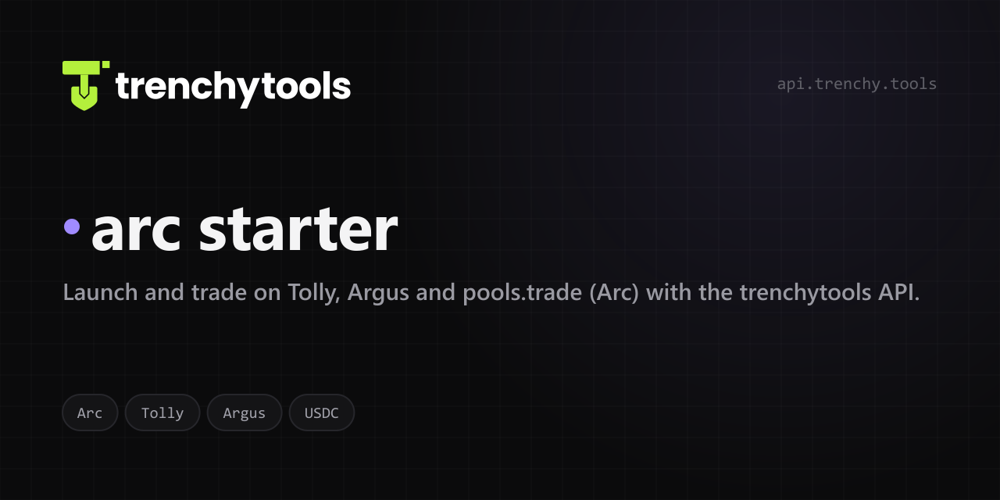

<!-- trenchytools:header -->
<p align="center"></p>

<p align="center"><a href="https://trenchy.tools/docs">Docs</a> · <a href="https://api.trenchy.tools/api/create-api-key">Get an API key</a> · <a href="https://api.trenchy.tools/AGENTS.md">AGENTS.md</a> · <a href="https://api.trenchy.tools/openapi.json">OpenAPI</a> · <a href="https://trenchy.tools/status">Status</a> · <a href="https://t.me/trenchytools">Telegram</a> · <a href="https://x.com/trenchytools">X</a></p>

# arc starter

The official starter for launching on **Tolly, Argus and pools.trade** (Arc, chain id 5042, native USDC) with the
[TrenchyTools API](https://api.trenchy.tools/AGENTS.md). One Next.js app, one process, one `npm run dev`. The same app as
the pump.fun and pons starters: the same pages, the same launch flow, a different `lib/chain.ts`.

Arc's native coin is USDC, so every amount is in dollars (gas too). Pick the launchpad on the Launch page: **Tolly** (the whole supply in a locked Uniswap V3 1 % pool, no curve), **Argus** (a Uniswap v4 pool with your own buy and sell tax, 0–20 %) or **pools.trade** (a hookless v4 pool from the launch block).

## What it does

- **Launch**: name, symbol, image (or **✨ Create with AI**), socials; who buys at launch (the main wallet, another wallet
  or a new one; first buyers, who buy right after the create (not in the same block); later buyers spread over a window; a volume maker in Calm / Normal / Wild); what happens
  after (auto-sell on outside money or a timer, the main wallet with the buyers, later or on its own trigger; auto-claim
  of the creator fees). A cost panel says what leaves the main wallet before anything is signed; a test run builds and
  simulates the create; the live log shows every step and hash.
- **Trading**: the chart, the live trades (ours marked), profit / loss from the chain (gas and fees in it), every wallet
  with Buy and 25 / 50 / 100 % sell, **Sell all at the same instant**, timed sells, and **Close out** (sell what is left,
  claim the creator fees, collect every wallet back to the main wallet, archive the run's wallets).
- **Wallets**: one list, each wallet a file in `./wallets`; fund, collect, send, export, archive.

The app holds your keys and signs locally with [viem](https://viem.sh). It never talks to an RPC node or IPFS: the API
builds every transaction (`POST /api/arc/trade-local`), tells the signer what the chain knows (`GET /api/arc/account`),
broadcasts (`POST /api/arc/send`) and confirms (`GET /api/arc/txs`). Live trades and the P/L come from
`GET /api/arc/trades` and `GET /api/arc/pnl`. Every trade pays the API's **0.5 % fee** as a small USDC transfer
that comes with it; nothing else is charged.

## 5-minute start

```bash
npm install
cp .env.example .env
curl "https://api.trenchy.tools/api/create-api-key?label=arc-starter"   # → { "apiKey": "…" }, shown once
# paste the key into .env as TRENCHY_API_KEY (or later in the app's Settings sheet)
npm run dev
```

Open http://localhost:3000. Create the main wallet at the top of the Launch page (its key file is written to `./wallets`
first, inside the clone, git-ignored) and send it 25 USDC on Arc. Start small (dev buy chips: 5–100 USDC) and press
**Test run** before the first launch.

## Where your keys are

`./wallets` (or `WALLET_BACKUP_DIR`): one JSON file per wallet, `{ publicKey, privateKey, chain: "arc", role, label }`,
plus `wallets.csv`. The folder can be shared with the other starters: each one lists only its own chain's files. A
wallet is written to its file **before** it is shown, funded or used, and nothing funds a wallet whose file is missing.
Archived wallets move to `archived/` (keys kept).

## Run it in a browser only

`NEXT_PUBLIC_DEMO=1 npm run dev`: the same pages, answered inside the tab (keys in the browser's storage, a backup file
downloads the moment a wallet is made). Nothing reaches this app's server.

## Change it

- `lib/chain.ts` is the chain: names, logos, explorer, amounts, fees, gas buffers, the API prefix and launchpad.
- `lib/trenchy.ts` is the API client (one method per endpoint); `lib/core/*` is the launch executor, trading and funding,
  shared by local and browser mode.
- Docs for every endpoint: [trenchy.tools/docs](https://trenchy.tools/docs) · [openapi.json](https://api.trenchy.tools/openapi.json).

MIT licensed.
